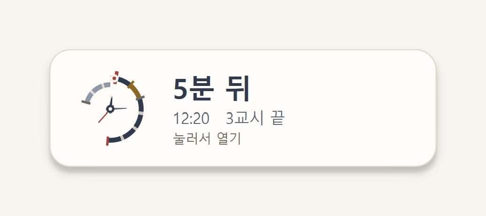
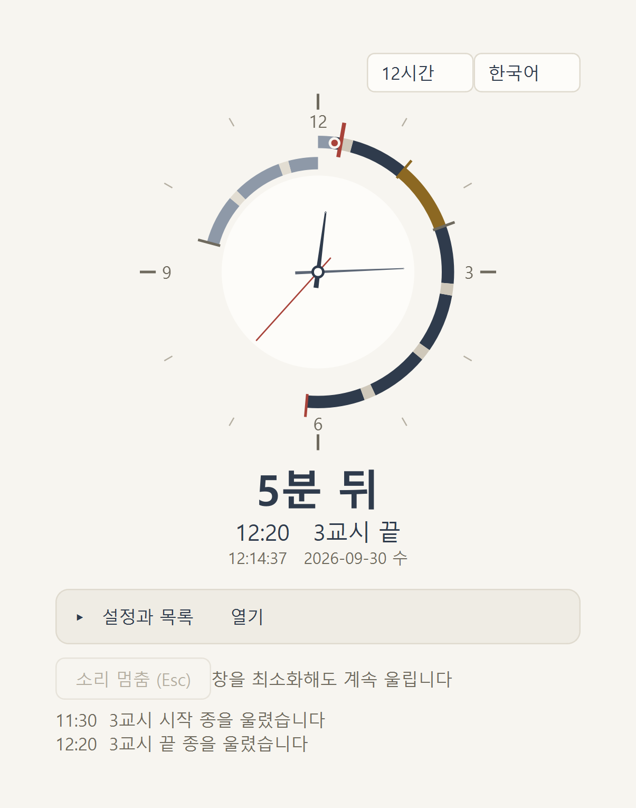
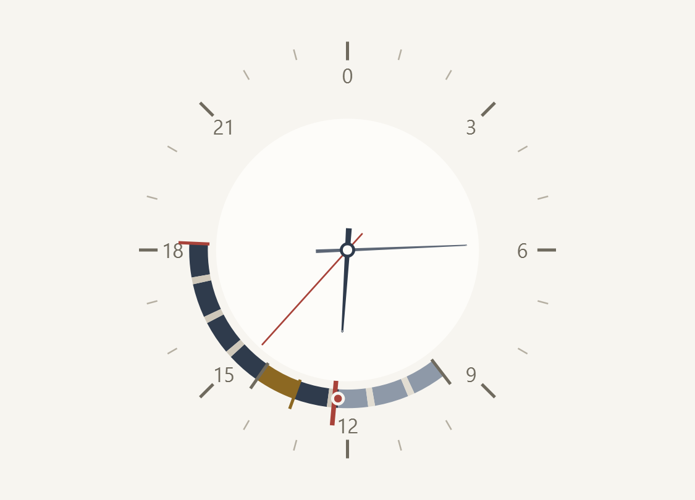
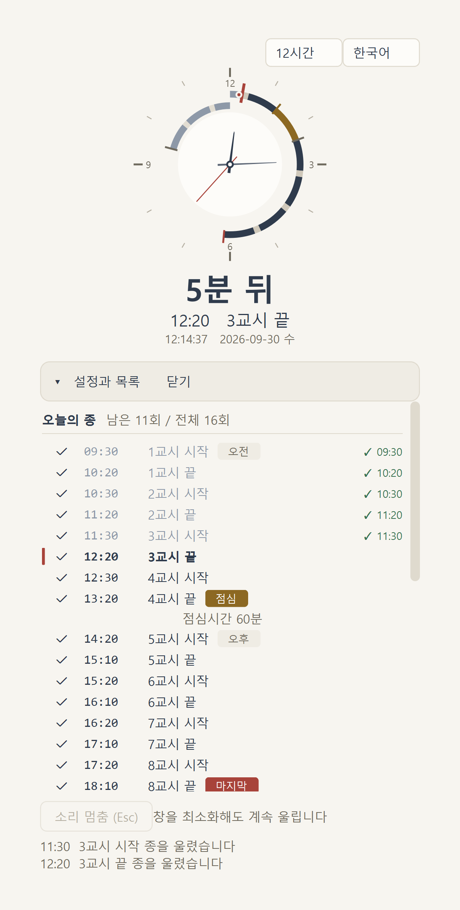
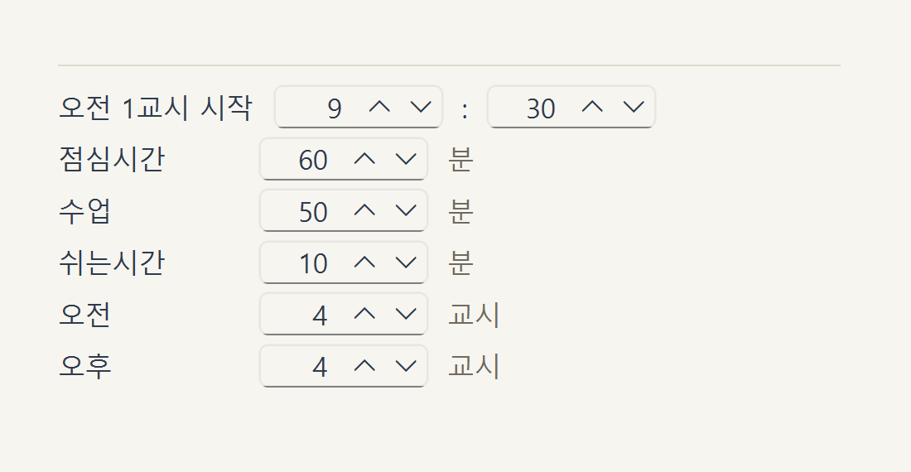

# 학교 종소리 알람 (School Bell)

수업 시간표에 맞춰 교시마다 종을 울려 주는 윈도우 데스크톱 알람.

**[⬇ 최신 버전 내려받기](https://github.com/yl-famaily/school_bell-releases/releases/latest)** · Windows 10 이상 (64비트) · 설치 과정 없이 파일 하나

## 어떤 앱인가요

종이 없는 교실, 학원, 스터디 카페, 온라인 수업을 위한 알람이에요. 시작 시각과 수업 길이만 정해 두면 1교시 시작부터 마지막 교시 끝까지 하루치 종을 알아서 계산해서 울려요.

평소에는 작은 위젯만 바탕화면에 떠 있어요. **다음 종까지 몇 분 남았는지**와 지금 시각을 보여주고, 아무 데나 끌어다 두면 그 자리를 기억해요. 항상 다른 창 위에 있어서 수업 자료를 띄워 놓아도 가려지지 않아요.

## 하루가 한눈에 보이는 원형 시계

위젯을 누르면 본창이 열려요. 시계가 하루 일정을 고리로 두르고 있어서, 지금이 하루의 어디쯤인지 시계를 보듯 읽을 수 있어요.

고리 색이 곧 시간표예요.

| 색 | 뜻 |
|---|---|
| 진한 남색 | 남은 수업 |
| 흐린 회청색 | 이미 지나간 수업 |
| 황토색 | 점심시간 |
| 고리 밖으로 뻗은 짧은 선 | 특별 종 (오전 · 점심 · 오후 · 마지막) |
| 굵은 붉은 선 | 다음에 울릴 종 |
| 붉은 점 | 지금 여기 |

**12시간**과 **24시간** 중에 고를 수 있어요. 12시간은 한 바퀴가 반나절이라 오전과 오후가 겹치기 때문에, 고리를 두 겹으로 두고 안쪽에 오전, 바깥쪽에 오후를 그려요. 24시간은 한 바퀴가 하루여서 시침 위치만 봐도 하루의 어디쯤인지 보여요.

## 오늘 울릴 종이 목록으로

시계 아래 `설정과 목록` 줄을 누르면 오늘의 종이 쭉 펼쳐져요. 열면 다음에 울릴 종으로 알아서 스크롤돼요.

- **굵은 글씨에 붉은 막대** — 다음에 울릴 종
- **오른쪽 `✓ 12:00`** — 실제로 울린 종
- **흐린 회색** — 이미 지난 종
- **취소선** — 체크를 꺼 둔 종

제목 옆에 `남은 5회 / 전체 16회` 처럼 남은 횟수가 나와요. 특정 교시만 종을 빼고 싶으면 그 줄의 체크만 끄면 돼요.

## 시간표는 숫자 몇 개만

**오전 1교시 시작 시각**과 **점심시간 길이**만 정하면 나머지 시각은 전부 자동으로 계산돼요. 교시마다 시각을 일일이 입력하지 않아도 돼요.

기본값(09:30 시작 · 수업 50분 · 쉬는시간 10분 · 오전 4교시 · 오후 4교시 · 점심 60분)이면 하루 **16회** 울려요.

| 교시 | 시작종 | 종료종 |
|---|---|---|
| 1교시 | **09:30** ← 오전 | 10:20 |
| 2교시 | 10:30 | 11:20 |
| 3교시 | 11:30 | 12:20 |
| 4교시 | 12:30 | **13:20** ← 점심 |
| 5교시 | **14:20** ← 오후 | 15:10 |
| 6교시 | 15:20 | 16:10 |
| 7교시 | 16:20 | 17:10 |
| 8교시 | 17:20 | **18:10** ← 마지막 |

울리는 요일도 고를 수 있어요. 기본은 월~금이고, 오늘이 안 울리는 요일이면 `일요일은 울리지 않습니다 · 다음 09/28(월)` 처럼 알려줘요.

**저장 버튼이 없어요.** 값을 바꾸면 바로 저장돼요.

## 종소리

기본 종소리는 프로그램이 직접 합성해요. 세 가지를 **첫 음부터 귀로 구분되게** 만들었어요.

| 종 | 소리 |
|---|---|
| 수업 시작 | 웨스트민스터 차임이 낮게 **내려가요** |
| 수업 종료 (쉬는시간) | 한 옥타브 위에서 밝게 **올라가요** |
| 오전 · 점심 · 오후 · 마지막 | 웨스트민스터 전곡, 가장 길게 |

수업 시작인지 끝인지를 첫 음만 듣고 알 수 있어요. 볼륨은 슬라이더로 맞추고, 미리듣기로 세 종류를 바로 들어 볼 수 있어요.

원하는 소리가 따로 있으면 **WAV 파일 선택**으로 지정하면 돼요 (PCM WAV만 돼요).

울리는 중에 **`Esc`** 를 누르면 즉시 멈춰요.

## 그 밖에

- **절전에서 깨어나도** 90초 안이면 놓친 종을 울려요. 그보다 오래 지난 종은 일부러 건너뛰어요 — 밤에 컴퓨터를 켰다고 아침 종이 몰아서 울리면 안 되니까요.
- **트레이 아이콘**으로 창 열기 · 위젯 숨기기 · 소리 멈춤 · 종료를 할 수 있어요.
- **언어** — 한국어 · English · 日本語 · 中文

## 설치

[Releases](https://github.com/yl-famaily/school_bell-releases/releases/latest) 에서 `school_bell-0.3.3.exe` 를 받아 원하는 폴더에 두고 더블클릭하면 끝이에요. 설치 과정이 없고 파일 하나(약 25MB)뿐이에요.

처음 실행할 때는 종소리를 합성하느라 몇 초 걸려요. 두 번째부터는 바로 떠요.

> 윈도우가 "PC를 보호했습니다" 라고 막으면 **추가 정보 → 실행**을 눌러 주세요. 코드 서명 인증서가 없어서 나오는 안내예요.

### 설정이 따라다녀요

설정(`config.json`)과 종소리(`sounds/`)는 **exe 를 둔 폴더 안에** 만들어져요. 그 폴더째 USB 에 담아 다른 PC 로 옮기면 시간표가 그대로 따라가요. 교실 컴퓨터가 바뀌어도 다시 설정하지 않아도 돼요.

레지스트리에 아무것도 쓰지 않고, 인터넷에 연결하지 않아요. 지우고 싶으면 폴더를 지우면 돼요.

### 윈도우 켤 때 자동 실행

1. `Win + R` → `shell:startup` → 확인
2. 열린 폴더에 exe 의 **바로가기**를 붙여넣기

## 자주 묻는 것

**여러 교실에서 시간표를 다르게 쓸 수 있나요?**
폴더를 나눠서 각각 exe 를 두면 폴더마다 다른 시간표로 돌아가요.

**소리를 잠깐 끄고 싶어요.**
울리는 중이면 `Esc` 또는 트레이 메뉴의 `소리 멈춤`. 특정 종만 빼려면 목록에서 그 줄의 체크를 끄면 돼요.

**창을 닫으면 종이 멈추나요?**
닫을 때 종료할지 물어봐요. `계속 실행`을 고르면 창만 숨고 알람은 계속 돌아요.

---

문제가 있거나 바라는 기능이 있으면 [이슈](https://github.com/yl-famaily/school_bell-releases/issues)로 알려 주세요.
